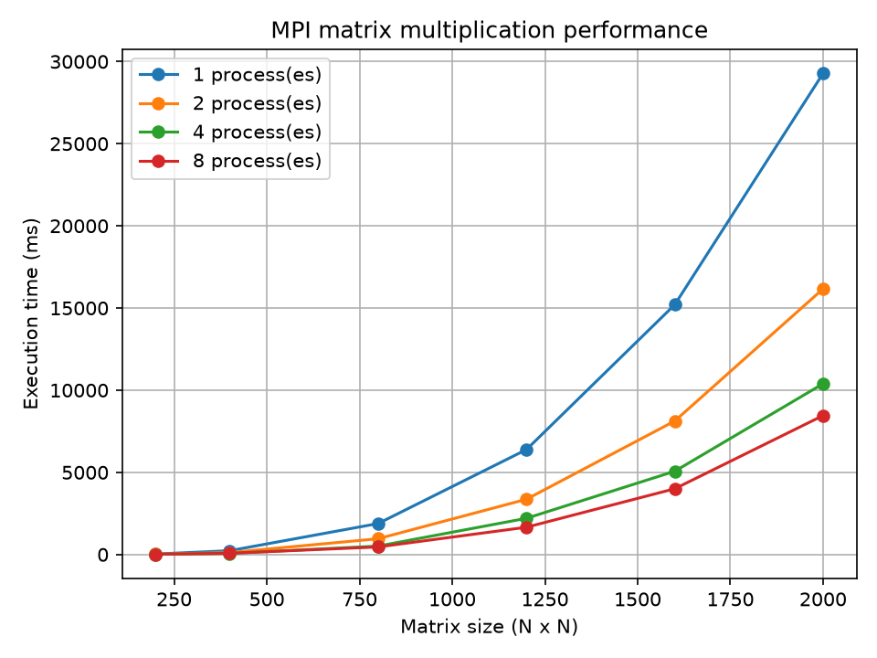
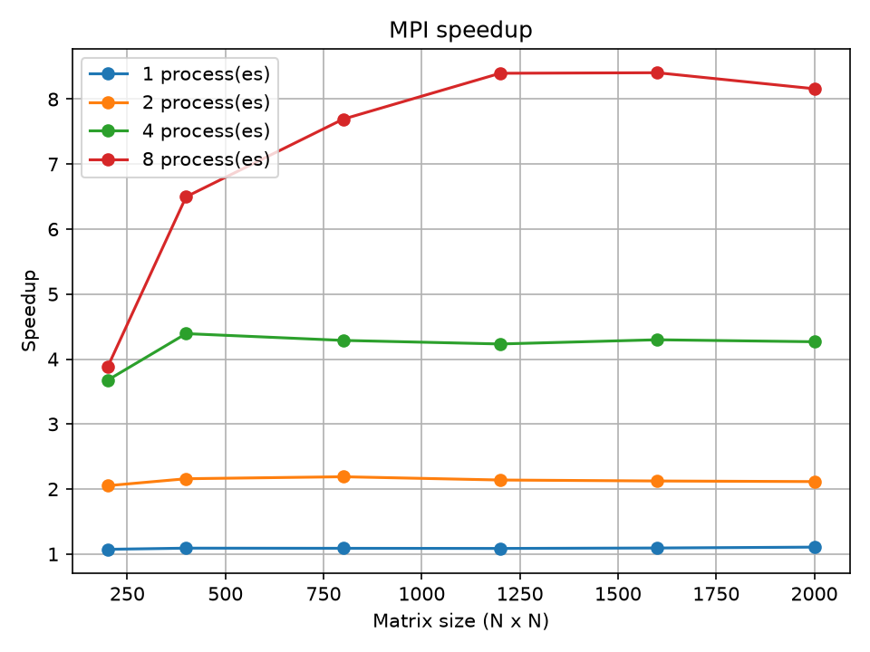
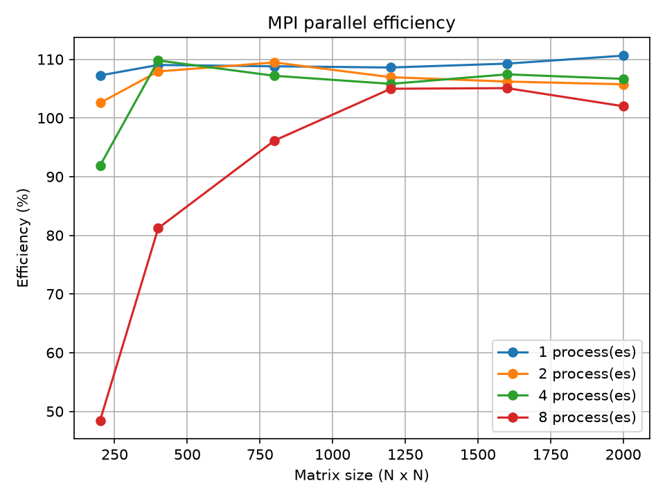

# Лабораторная работа № 3. Умножение матриц с использованием MPI

## Задание

Написать программу на языке C++ для перемножения двух квадратных матриц с использованием технологии параллельного программирования MPI.

**Входные данные:** файлы `A.txt` и `B.txt` со значениями исходных матриц.

**Выходные данные:** файл `C.txt` со значениями результирующей матрицы, время выполнения, размер задачи и количество MPI-процессов.

**Верификация:** автоматизированная проверка результатов с помощью сторонней библиотеки NumPy.

**Исследование производительности:** сравнение последовательного и параллельного умножения матриц при различном количестве MPI-процессов.

## Реализация

Программа состоит из следующих частей:

- `main.cpp` — программа на C++, которая считывает исходные матрицы, выполняет последовательное и параллельное умножение и записывает результат в `C.txt`.
- `gen.py` — генератор исходных матриц `A.txt` и `B.txt` заданного размера.
- `verify.py` — проверка правильности вычислений с помощью NumPy.
- `experiment.py` — автоматическое проведение экспериментов, измерение времени выполнения и сохранение результатов.
- `plot.py` — построение графиков производительности, ускорения и эффективности.
- `results.csv` — таблица результатов экспериментов.
- `performance.png` — график зависимости времени выполнения от размера матрицы.
- `speedup.png` — график ускорения.
- `efficiency.png` — график эффективности параллельных вычислений.

Для реализации параллельных вычислений используется технология **MPI (Message Passing Interface)**. Исходные матрицы распределяются между процессами, каждый процесс вычисляет свою часть результирующей матрицы. После завершения вычислений результаты объединяются.

## Алгоритм умножения

Используется классический алгоритм умножения квадратных матриц. Для каждого элемента результирующей матрицы вычисляется сумма произведений соответствующих элементов исходных матриц:

\[
C*{ij}=\sum*{k=0}^{n-1}A*{ik}B*{kj}
\]

где:

- \(A\) и \(B\) — исходные матрицы;
- \(C\) — результирующая матрица;
- \(n\) — размер квадратной матрицы.

Количество арифметических операций имеет порядок \(2n^3\).

Временная сложность классического алгоритма составляет:

\[
O(n^3)
\]

При параллельной реализации вычисления распределяются между несколькими MPI-процессами, что позволяет сократить время выполнения для достаточно больших матриц.

## Методика эксперимента

Эксперименты проводились на персональном компьютере под управлением macOS.

Параметры эксперимента:

- **Операционная система:** macOS.
- **Компилятор:** AppleClang.
- **Стандарт языка:** C++23.
- **Технология параллелизации:** MPI (Open MPI 5.0.11).
- **Размеры матриц:** 200, 400, 800, 1200, 1600, 2000.
- **Количество MPI-процессов:** 1, 2, 4, 8.
- **Количество повторений:** 3 для каждой комбинации размера матрицы и количества процессов.

Всего было проведено 72 измерения.

Для каждой комбинации размера матрицы и количества MPI-процессов выполнялось три запуска программы. В качестве времени параллельного выполнения использовалось среднее арифметическое трёх измерений.

Ускорение вычислялось по формуле:

\[
S=\frac{T*{\text{последовательное}}}{T*{\text{параллельное}}}
\]

Эффективность параллельных вычислений определялась по формуле:

\[
E=\frac{S}{p}\cdot100\%
\]

где:

- \(T\_{\text{последовательное}}\) — время последовательного выполнения;
- \(T\_{\text{параллельное}}\) — время параллельного выполнения;
- \(p\) — количество MPI-процессов.

## Результаты экспериментов

### Таблица 1. Зависимость времени выполнения от размера матрицы

В таблице приведены результаты для восьми MPI-процессов.

| Размер матрицы | Последовательное время, мс | Параллельное время, мс | Ускорение |
| -------------: | -------------------------: | ---------------------: | --------: |
|      200 × 200 |                     55,426 |                 14,298 |    3,877× |
|      400 × 400 |                    496,295 |                 76,380 |    6,498× |
|      800 × 800 |                   3545,078 |                460,869 |    7,692× |
|    1200 × 1200 |                  13941,461 |               1660,053 |    8,398× |
|    1600 × 1600 |                  33642,289 |               4001,884 |    8,407× |
|    2000 × 2000 |                  69008,409 |               8456,691 |    8,160× |

По результатам экспериментов максимальное ускорение составило приблизительно 8,41 раза при размере матрицы 1600 × 1600 и использовании восьми MPI-процессов.

### Таблица 2. Зависимость времени выполнения от количества MPI-процессов

Результаты для матрицы размером 2000 × 2000.

| Количество процессов | Время выполнения, мс | Ускорение |
| -------------------: | -------------------: | --------: |
|                    1 |            29277,471 |    1,106× |
|                    2 |            16166,737 |    2,115× |
|                    4 |            10392,479 |    4,267× |
|                    8 |             8456,691 |    8,160× |

По мере увеличения количества MPI-процессов время выполнения уменьшается. Наибольшее ускорение в данном эксперименте получено при использовании восьми процессов.

### График 1. Производительность

На графике представлена зависимость времени выполнения последовательного и параллельного алгоритмов от размера матрицы.



### График 2. Ускорение

График показывает изменение ускорения в зависимости от размера матрицы и количества MPI-процессов.



### График 3. Эффективность

На графике представлена эффективность параллельных вычислений при использовании различного количества MPI-процессов.



## Верификация

Корректность вычислений проверяется с помощью скрипта `verify.py`.

Сначала с помощью NumPy вычисляется контрольное произведение исходных матриц. Затем полученный результат сравнивается с матрицей `C.txt`, сформированной программой на C++.

Пример запуска:

```bash
python gen.py 200
mpirun -np 2 ./build/matrix
python verify.py
```

В ходе проверки было получено сообщение:

```text
OK: matrices match
```

Это подтверждает совпадение результата программы с контрольным вычислением NumPy.

## Выводы

В ходе лабораторной работы была реализована программа на языке C++ для последовательного и параллельного умножения квадратных матриц с использованием технологии MPI.

Была реализована передача данных между процессами, распределение вычислений и объединение результатов в итоговую матрицу.

Проведено исследование производительности на матрицах размером от 200 × 200 до 2000 × 2000 с использованием 1, 2, 4 и 8 MPI-процессов. Для каждой комбинации было выполнено три измерения.

Эксперименты показали, что с увеличением размера матрицы время вычислений значительно возрастает, что соответствует кубической временной сложности классического алгоритма \(O(n^3)\).

При увеличении количества MPI-процессов время выполнения параллельной программы уменьшается. Для матрицы размером 2000 × 2000 при использовании восьми процессов ускорение составило приблизительно 8,16 раза по сравнению с последовательным выполнением.

Максимальное полученное ускорение составило приблизительно 8,41 раза для матрицы размером 1600 × 1600 при использовании восьми процессов.

Следует учитывать, что эксперимент проводился на персональном компьютере, поэтому на результаты могли влиять системная нагрузка, особенности работы процессора и накладные расходы MPI. В отдельных измерениях эффективность превышает 100%, что связано с различиями условий измерения последовательного и параллельного времени и нестабильностью нагрузки системы.

В результате лабораторной работы были изучены основы параллельных вычислений с использованием MPI, проведена проверка корректности вычислений с помощью NumPy и выполнен анализ производительности программы при различном количестве процессов.
